# Folio

Folio is a collaborative document editor for teams. It's similar to Quip or Obsidian, but every
document is a **plain Markdown file**: you see formatting rendered as you type, you can link
documents and paragraphs together, share with people and `@mention` them, and export everything
whenever you like. It runs as a single container and ships with a Helm chart for Kubernetes.

It also has extras for **data scientists and software engineers**: KaTeX math, Mermaid, Graphviz
and PlantUML diagrams, Vega-Lite charts, sortable CSV tables, Jupyter notebook and Parquet
previews, runnable Python cells (Pyodide), GitHub and Jira embeds, Git sync, Vim and Emacs
keybindings, ADR/RFC/postmortem/experiment/model-card templates, a REST API with personal tokens,
and a CLI.

## Screenshots

**Live editing.** Markdown formats in place; comments are anchored to text and threaded.

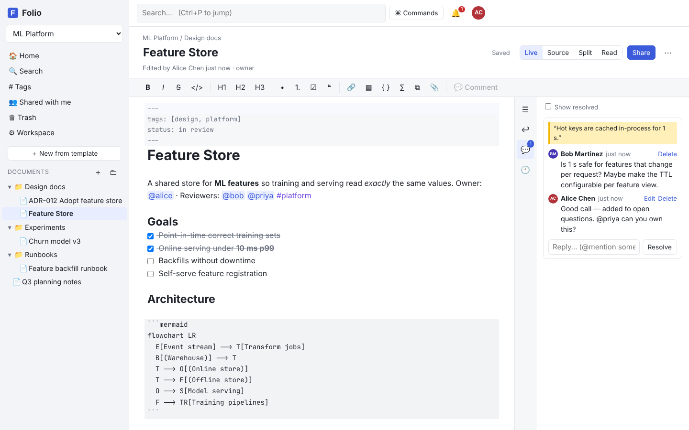

| Data science: math, a Vega-Lite chart and a sortable table          | Jupyter notebook cells and runnable Python                              |
| ------------------------------------------------------------------- | ----------------------------------------------------------------------- |
| 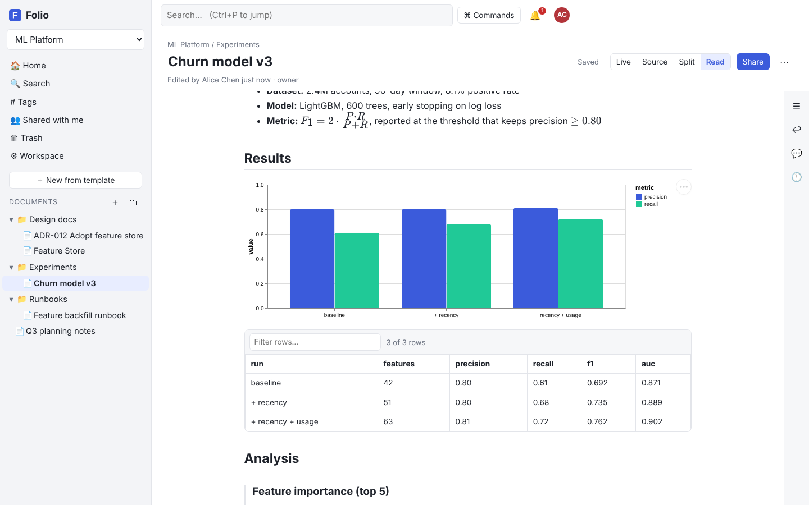   | 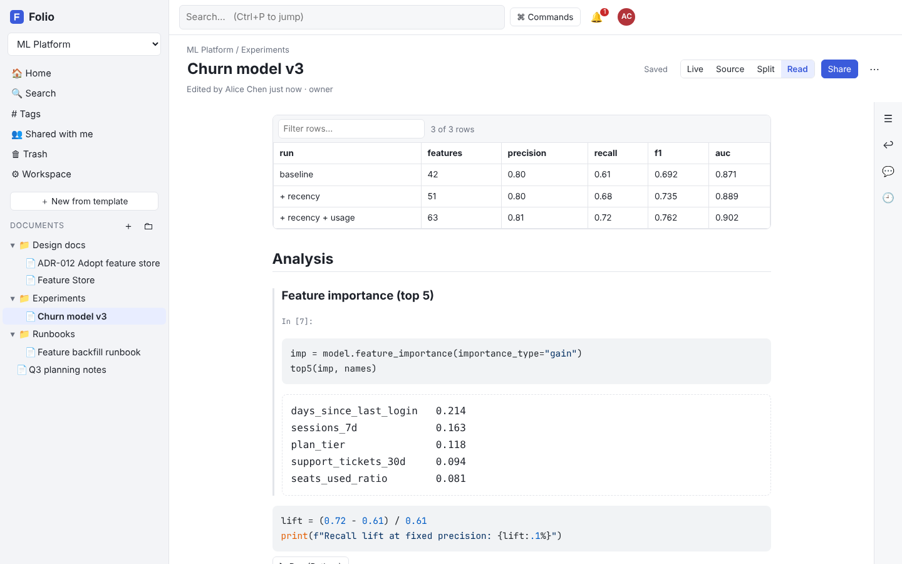              |
| **Split view** with a rendered Mermaid diagram                      | **Backlinks**, including links to a specific paragraph                  |
| 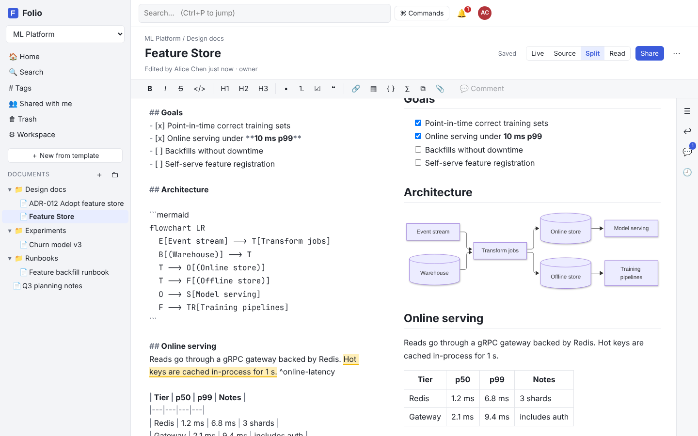 | 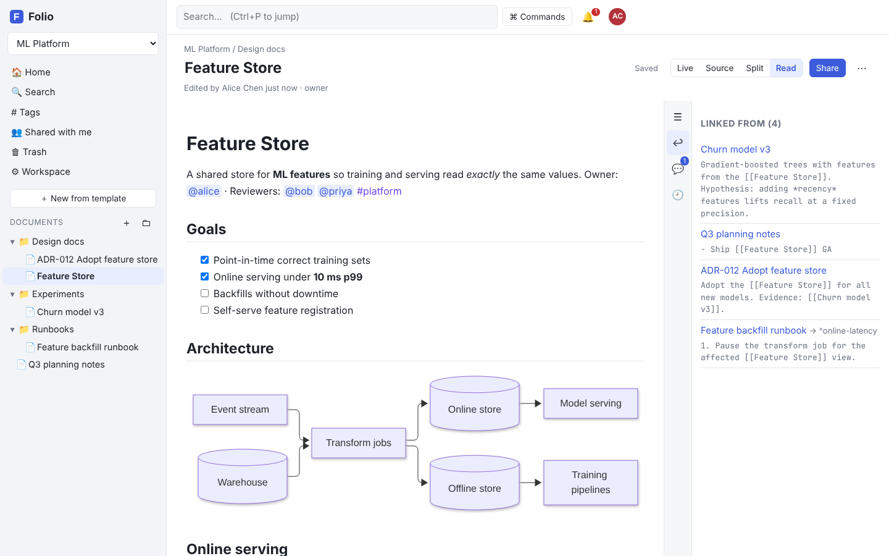                      |
| **Sharing**: per-person roles, workspace members, public links      | **Templates** for engineering and data science                          |
| 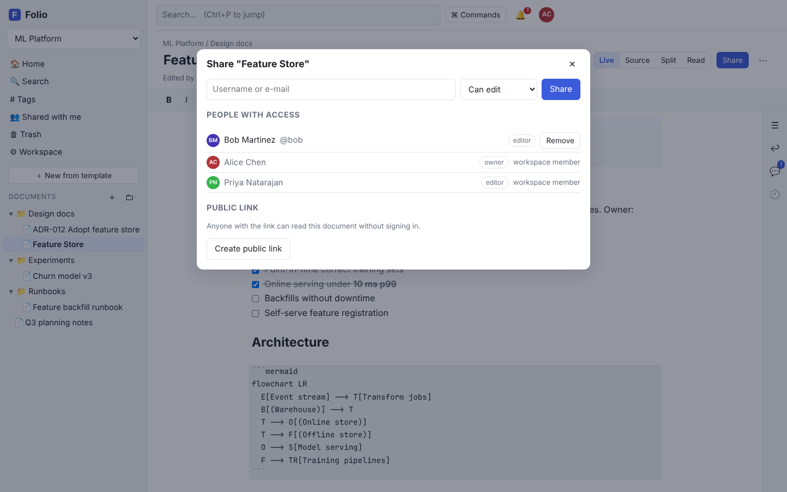                         | 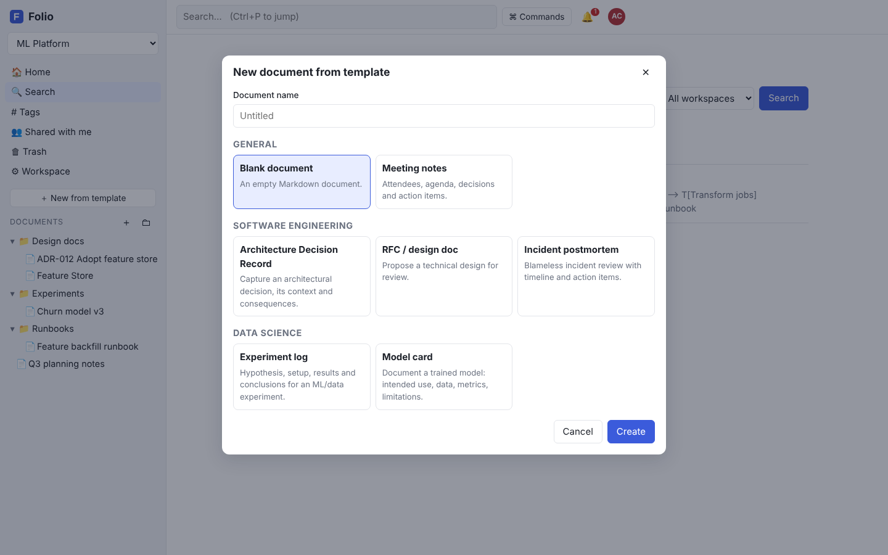                      |
| **Full-text search** across everything you can access               | **Command palette** (`Ctrl/⌘+K`)                                        |
| 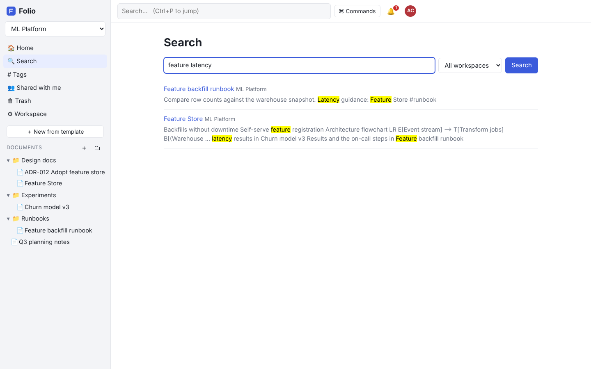                      | 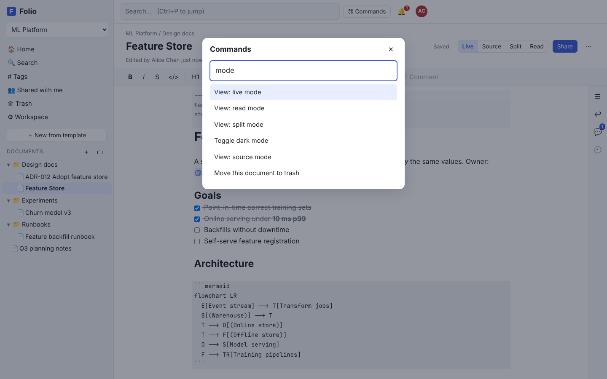                |
| **Dark mode**                                                       | **Mobile**                                                              |
| 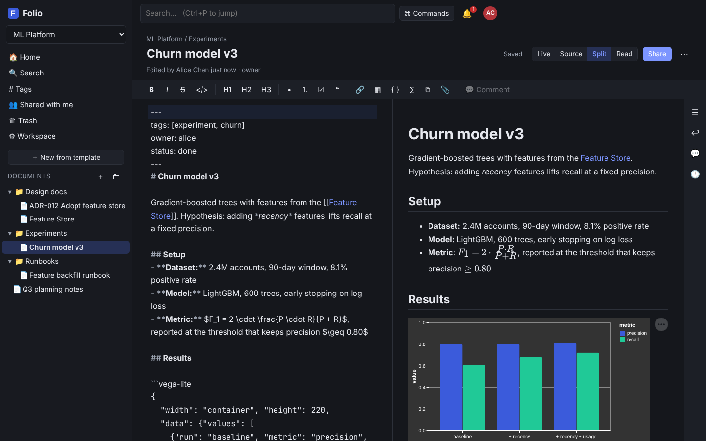            | 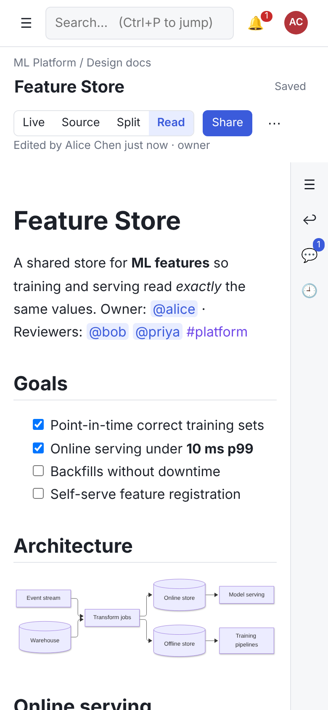 |

Screenshots are generated from a seeded demo instance with `node scripts/screenshots.mjs` (after
`pnpm build`), so they can be refreshed whenever the UI changes.

## Features

| Area          | What you get                                                                                                                                                                                                                                                                       |
| ------------- | ---------------------------------------------------------------------------------------------------------------------------------------------------------------------------------------------------------------------------------------------------------------------------------- |
| Editing       | CodeMirror 6 with **live preview**: Markdown marks are hidden except on the line you're editing. Source, split and read modes; a formatting toolbar; `/` slash commands; keyboard shortcuts; paste or drop images; autosave.                                                       |
| Plain files   | Each document is a `.md` file in object storage. You can export a workspace or folder as a zip, import `.md` files or a zip (e.g. an Obsidian vault), and download any single document.                                                                                            |
| Linking       | `[[Doc]]`, `[[Doc#Heading]]`, `[[Doc#^block-id]]` and `[[Doc\|alias]]`, with autocomplete and a backlinks panel. Broken links are shown, and renaming a document rewrites links to it.                                                                                             |
| Collaboration | Sharing as viewer, commenter or editor on documents and folders (folders pass access down). `@mentions` notify people in the app and by e-mail. You can comment on a text selection, with threaded replies and a resolve action. Presence avatars and live updates use WebSockets. |
| Organisation  | Folders with drag and drop, `#tags` and front-matter tags, full-text search (Postgres), quick switcher (`Ctrl/⌘+P`), command palette (`Ctrl/⌘+K`), trash and restore, version history with diff and restore.                                                                       |
| Accounts      | Sign-up with e-mail verification and password reset. The first user becomes admin. Admins can set sign-up to open, domain-restricted, invite-only or closed. Optional OIDC single sign-on. Personal API tokens.                                                                    |
| Ops           | Stateless app with Postgres and S3/MinIO (or a local filesystem). Health and readiness probes, Prometheus `/metrics`, OpenTelemetry tracing, graceful shutdown, a Helm chart with autoscaling, a PDB and a NetworkPolicy.                                                          |

## Quick start

```bash
docker compose up -d        # Postgres, MinIO, Mailpit (e-mail UI on :8025) and Folio
open http://localhost:3000  # the first account you create is the administrator
```

Development, running the app from source with hot reload:

```bash
pnpm install
docker compose up -d db mailpit
cp .env.example .env
pnpm dev                    # API on :3000, web on http://localhost:5173
```

## Repository layout

```
apps/server         Fastify API, auth, storage drivers, realtime (WebSocket + LISTEN/NOTIFY), git sync
apps/web            React + CodeMirror 6 editor, live preview, renderers for diagrams, charts and data
packages/markdown   Shared parser and renderer: wiki links, mentions, tags, block ids, templates
packages/cli        `folio` command-line client (pull, push, search, cat, new)
deploy/docker       Multi-stage Dockerfile (non-root runtime image)
deploy/helm/folio   Helm chart
e2e                 Playwright end-to-end tests
loadtest            k6 load test
docs                Architecture, configuration, deployment and user guide
```

## Testing

| Suite           | Command                                  | What it covers                                                                                                                                                      |
| --------------- | ---------------------------------------- | ------------------------------------------------------------------------------------------------------------------------------------------------------------------- |
| Unit            | `pnpm --filter @folio/markdown test`     | Parser and renderer: link, tag and mention extraction, offsets, sanitising, link rewriting                                                                          |
| Web unit        | `pnpm --filter @folio/web test`          | Formatting commands, live-preview decorations, completions, notebook and table renderers                                                                            |
| API integration | `pnpm --filter @folio/server test`       | Real Postgres (Testcontainers or `TEST_DATABASE_URL`) and S3 (s3mock): auth, documents, permission matrix, notifications, WebSockets, Git sync, embeds, SPA serving |
| CLI             | `pnpm --filter @folio/cli test`          | Argument parsing, zip safety, API client                                                                                                                            |
| End-to-end      | `pnpm test:e2e`                          | Browser flows: sign-up → create doc → link → share → mention → notification, comments, history, templates, public links, folders, mobile                            |
| Load            | `k6 run -e BASE_URL=… loadtest/folio.js` | Concurrent saves, reads and search, with p95 thresholds                                                                                                             |

## Engineering standards

CI enforces lint, Prettier formatting, type checks, coverage thresholds (server ≥ 80% lines,
markdown package ≥ 95%), the full test pyramid above, a dependency audit, Helm lint and the
container build. Dependabot keeps dependencies current. See [CONTRIBUTING.md](CONTRIBUTING.md)
for the coding standards and [SECURITY.md](SECURITY.md) for vulnerability reporting and an
operator hardening checklist.

See [docs/](docs) for [architecture](docs/architecture.md), [configuration](docs/configuration.md),
[deployment](docs/deployment.md) and the [user guide](docs/user-guide.md).
